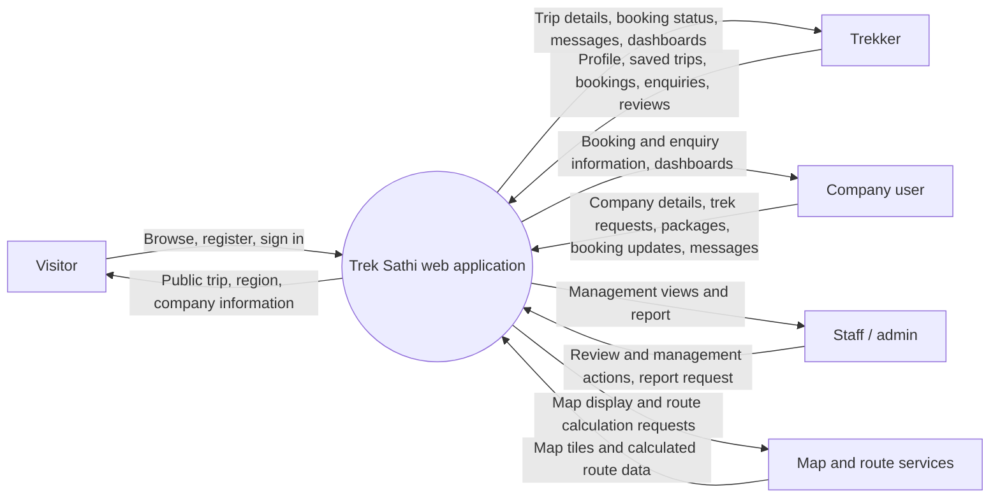
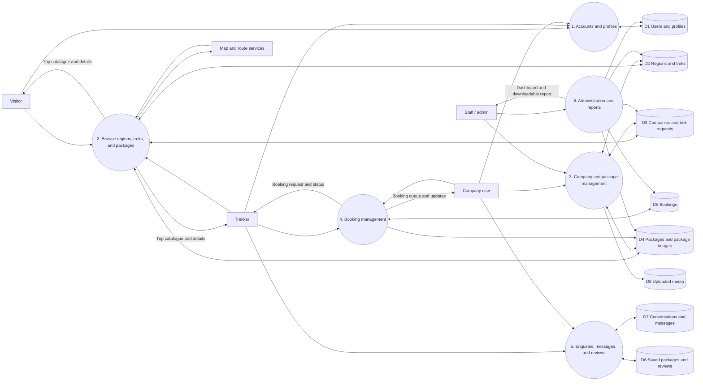
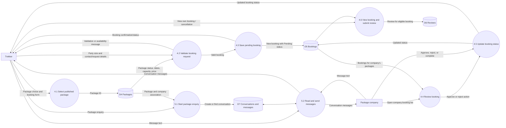

# Trek Sathi Project Documentation

## 1. Project overview

Trek Sathi is a Django web application for discovering trekking trips and connecting trekkers with trekking companies. It supports user and company accounts, regions and treks, company packages, bookings, saved packages, reviews, enquiries and messages, and administrative dashboards and reports.

The project uses Django's built-in `User` model, Django templates and forms, and SQLite as configured in the project settings. Uploaded images and company documents are stored as media files. Package route coordinates are stored as JSON. The application exposes MapTiler configuration to templates and includes a route calculation endpoint.

## 2. User roles and main capabilities

- **Visitor:** View the homepage, companies, regions, treks, and published packages; register or sign in.
- **Trekker:** Maintain a profile, save packages, book packages, view bookings, send enquiries and messages, and review a booking.
- **Company:** Maintain company information, submit trek requests, manage packages, see and update bookings, and communicate with trekkers.
- **Staff/admin:** Access administration pages, review companies and trek requests, view project data, and download a report.

These are functional roles in the project. Access checks differ by view; see “Implementation notes” below for current behavior relevant to interpreting the diagrams.

## 3. DFD Level 0 — Context diagram

The context diagram treats Trek Sathi as one process and shows its external actors and data exchanges.



## 4. DFD Level 1 — Major application processes



## 5. DFD Level 2 — Booking and package enquiry detail

This decomposition follows the package booking and enquiry flows. Bookings currently record the selected package, trekker, party size, emergency contact, special request, total price, and booking status. The enquiry flow creates a conversation associated with the package, trekker, and company.



## 6. ER diagram

The diagram shows application entities and their database relationships. `User` is Django's built-in authentication model. Admin/staff status is represented by fields on that model, not a separate entity in this project.

```mermaid
erDiagram
    USER ||--o| PROFILE : has
    USER ||--o| COMPANY : owns
    COMPANY ||--o{ TREK_REQUEST : submits
    REGION ||--o{ TREK_REQUEST : requested_for
    REGION ||--o{ TREK : contains
    COMPANY ||--o{ PACKAGE : offers
    TREK ||--o{ PACKAGE : describes
    PACKAGE ||--o{ PACKAGE_IMAGE : has
    USER ||--o{ SAVED_PACKAGE : saves
    PACKAGE ||--o{ SAVED_PACKAGE : saved_as
    USER ||--o{ BOOKING : makes
    PACKAGE ||--o{ BOOKING : receives
    USER ||--o{ REVIEW : writes
    PACKAGE ||--o{ REVIEW : receives
    BOOKING ||--o| REVIEW : may_be_reviewed_by
    USER ||--o{ CONVERSATION : starts
    COMPANY ||--o{ CONVERSATION : handles
    PACKAGE ||--o{ CONVERSATION : concerns
    CONVERSATION ||--o{ MESSAGE : contains
    USER ||--o{ MESSAGE : sends

    USER {
        int id PK
        string username
        string email
        bool is_staff
        bool is_superuser
    }
    PROFILE {
        int id PK
        int user_id FK
        string phone
        date date_of_birth
        string gender
        text address
    }
    COMPANY {
        int id PK
        int user_id FK
        string company_name
        string registration_number UK
        string status
        bool is_active
        text admin_feedback
    }
    REGION {
        int id PK
        string name UK
        text description
        bool is_active
    }
    TREK {
        int id PK
        int region_id FK
        string name
        int altitude
        string difficulty
        bool is_active
    }
    TREK_REQUEST {
        int id PK
        int company_id FK
        int region_id FK
        string trek_name
        string status
        text admin_feedback
    }
    PACKAGE {
        int id PK
        int company_id FK
        int trek_id FK
        string title
        decimal price_per_person
        date start_date
        date end_date
        string status
        json route_points
    }
    PACKAGE_IMAGE {
        int id PK
        int package_id FK
        string image
    }
    SAVED_PACKAGE {
        int id PK
        int trekker_id FK
        int package_id FK
        datetime saved_at
    }
    BOOKING {
        int id PK
        int trekker_id FK
        int package_id FK
        int number_of_people
        decimal total_price
        string status
        datetime booking_date
    }
    REVIEW {
        int id PK
        int trekker_id FK
        int package_id FK
        int booking_id FK UK
        int rating
        datetime created_at
    }
    CONVERSATION {
        int id PK
        int trekker_id FK
        int company_id FK
        int package_id FK
        string subject
        string status
    }
    MESSAGE {
        int id PK
        int conversation_id FK
        int sender_id FK
        text message
        bool is_read
        datetime created_at
    }
```

### Relationship notes

- A `User` can have one `Profile` and can own one `Company`; both links are one-to-one and optional from the user's perspective.
- A `Company` submits many `TrekRequest` records and offers many `Package` records.
- A `Region` contains many `Trek` records. Both `Trek` and `Region` can be referenced by packages and trek requests respectively.
- A `Package` can have multiple gallery images, bookings, saved-package associations, reviews, and conversations.
- `SavedPackage` prevents duplicate saves for the same user/package pair.
- Each `Review` belongs to one `Booking` through a one-to-one field, so a booking can have at most one review.
- A `Conversation` links a trekker, company, and package; each conversation contains messages sent by users.

## 7. Main workflows

1. A user registers or signs in as a trekker or company account.
2. A visitor or signed-in user browses regions, treks, companies, and published packages.
3. A company creates packages tied to a trek and manages package availability and trip details.
4. A trekker books a published package. The booking begins in `Pending`; the company can update the booking status.
5. A trekker can save packages, start an enquiry, exchange messages with a company, and submit a review associated with a booking.
6. Staff-facing pages provide company and trek-request review, dashboards, and report generation.

## 8. Implementation notes

- The diagrams describe the models and flows currently present in the repository; they do not imply that every role check is consistently enforced.
- Some company moderation and trek-request review views do not contain staff-only checks, while the region and trek management views require login but do not check staff status. This documentation records that code behavior without changing it.
- Project settings currently set `DEBUG = True` and `ALLOWED_HOSTS = []`; these are development-oriented settings and should be reviewed for deployment.
- No payment entity or payment gateway flow appears in the inspected models and routes. Booking totals are stored on `Booking`.
- Uploaded media and route-map integrations are shown as external/storage flows, but their deployment configuration is outside this document.

## 9. Project modules

| Module | Responsibility |
| --- | --- |
| `accounts` | Trekker/company registration, sign-in, profile, and saved/booked account pages |
| `companies` | Company profile and status, company trek requests, company pages |
| `regions` | Trekking regions and region pages |
| `treks` | Trek catalogue and trek records |
| `packages` | Package catalogue, package management, route calculation, saved packages |
| `bookings` | Booking creation, company decisions, cancellation, and booking detail |
| `reviews` | Reviews linked to package bookings |
| `messaging` | Package enquiries, conversations, and messages |
| `dashboard` | Trekker dashboard and booking summary |
| `adminpanel` | Staff dashboards, review pages, and downloadable report |
| `home` | Public homepage and shared static assets |
| `trek_sathi` | Django project settings, root URLs, and context processors |

## 10. Detailed data dictionary

This section lists the application-owned Django models and their fields. Django also creates its own authentication, session, permission, and migration tables; those framework tables are not repeated here. `id` is the implicit primary key on each model unless otherwise stated.

### Accounts and companies

| Entity | Fields |
| --- | --- |
| `User` (Django built-in) | Authentication identity and credentials, username, email, first/last name, active/staff/superuser flags, and login metadata. Application models reference this entity. |
| `Profile` | `user` (one-to-one User), `phone`, `date_of_birth`, `gender` (`Male`, `Female`, `Other`), `address`. A signal creates and saves a profile with its user. |
| `Company` | `user` (one-to-one User), `company_name`, `phone`, optional `email`, unique `registration_number`, `address`, `description`, optional `logo`, optional `registration_document`, `status` (`Pending`, `Approved`, `Rejected`, `Suspended`; default `Pending`), `is_active` (default true), optional `admin_feedback`, `approval_message_seen` (default false), `created_at`. |
| `TrekRequest` | `company` (FK), `region` (FK), `trek_name`, `description`, optional positive `estimated_altitude`, `difficulty` (`Easy`, `Moderate`, `Hard`, `Extreme`), optional `reference_image`, `admin_feedback`, `status` (`Pending`, `Approved`, `Rejected`; default `Pending`), `created_at`, `updated_at`. |

### Trek catalogue and packages

| Entity | Fields |
| --- | --- |
| `Region` | Unique `name`, `description`, `image`, `is_active` (default true), `created_at`. Ordered by name. |
| `Trek` | `region` (FK), `name`, `description`, positive `altitude`, `difficulty` (`Easy`, `Moderate`, `Hard`, `Extreme`), optional `image`, `is_active` (default true), `created_at`. Ordered by name. |
| `Package` | `company` (FK), `trek` (FK), optional `cover_image`, `title`, decimal `price_per_person`, positive `duration`, positive `max_participants`, `is_featured`, `start_date`, `end_date`, `difficulty` (`Easy`, `Moderate`, `Hard`), positive `max_altitude`, `inclusions`, `exclusions`, `itinerary`, JSON `route_points` (default empty list), `status` (`Draft`, `Published`, `Hidden`; default `Draft`), `created_at`, `updated_at`. |
| `PackageImage` | `package` (FK), `image`. Each row is one gallery image. |
| `SavedPackage` | `trekker` (FK to User), `package` (FK), `saved_at`. Unique together on trekker and package. |

`Package` also exposes computed values: `is_expired`, `has_started`, `occupied_slots`, `remaining_slots`, `is_full`, and `is_available_for_booking`. Occupied slots count bookings in `Pending`, `Approved`, or `Completed` status.

### Transactions and communication

| Entity | Fields |
| --- | --- |
| `Booking` | `trekker` (FK to User), `package` (FK), `booking_date`, positive `number_of_people` (default 1), `emergency_contact`, optional `special_request`, decimal `total_price`, `status` (`Pending`, `Approved`, `Rejected`, `Completed`, `Cancelled`; default `Pending`), `created_at`, `updated_at`. |
| `Review` | `trekker` (FK to User), `package` (FK), `booking` (one-to-one FK), `rating` (1–5), `created_at`, `updated_at`. Ordered newest first. |
| `Conversation` | `trekker` (FK to User), `company` (FK), `package` (FK), `subject`, `status` (`Open`, `Closed`; default `Open`), `created_at`. |
| `Message` | `conversation` (FK), `sender` (FK to User), `message`, `created_at`, `is_read` (default false). Ordered oldest first. |

### Data not represented by a custom model

- Package route waypoints are stored in the `Package.route_points` JSON field rather than a separate route-point table.
- Image and document content is stored through Django file fields; the relational rows store the file names/paths, not the binary content.
- There is no custom payment, invoice, notification, or audit-log model in the application models inspected for this document.
- The `adminpanel`, `dashboard`, and `home` apps do not define custom database models in their model modules.

## 11. URL and page inventory

The paths below are mounted under the prefixes shown. The table documents the current URL configuration; it is not a promise that every view applies the same role checks.

| Prefix | Routes | Purpose |
| --- | --- | --- |
| `/admin/` | Django admin site | Framework administration interface. |
| `/` | `/` | Homepage with latest published packages and active regions; staff users are redirected to the admin dashboard. |
| `/accounts/` | `login/`, `register/`, `login/trekker/`, `login/company/`, `register/trekker/`, `register/company/`, `logout/`, `profile/`, `my-bookings/`, `saved-packages/` | Account choices, separate trekker/company registration and login, logout, profile, booking list, and saved package list. |
| `/companies/` | `/`, `<id>/`, `dashboard/`, `packages/`, `bookings/`, `messages/`, `earnings/`, `reviews/`, `profile/`, `profile/edit/`, `verification/`, `verification/replace-document/`, `trek-requests/`, `approval-message-dismiss/`, `<id>/approve/`, `<id>/reject/`, `<id>/suspend/`, `report/download/` | Public company directory/detail, company workspace, profile/document updates, trek requests, moderation actions, and company report. |
| `/packages/` | `/`, `explore/`, `add/`, `<id>/`, `company/<id>/`, `<id>/edit/`, `<id>/delete/`, `save/<package_id>/`, `saved/`, `api/calculate-route/` | Company package list and management, public exploration and details, save/unsave flows, and route calculation API. |
| `/bookings/` | `/`, `create/<package_id>/`, `<id>/`, `<id>/approve/`, `<id>/reject/`, `<id>/complete/`, `cancel/<id>/` | Company booking queue, booking creation/detail, company status updates, and trekker cancellation. |
| `/reviews/` | `/`, `create/<booking_id>/` | Company review list and trekker review submission. |
| `/messages/` | `/`, `<id>/`, `enquiry/<package_id>/`, `my-conversations/` | Company inbox, conversation detail, new package enquiry, and trekker conversation list. |
| `/dashboard/` | `trekker/`, `my-bookings/` | Trekker dashboard and booking summary. |
| `/adminpanel/` | `dashboard/`, `regions/`, `treks/`, `companies/`, `users/`, `trek-requests/`, `trek-requests/<id>/`, `report/download/` | Staff dashboard, administration views, trek-request review, and report download. |
| `/regions/` | `/`, `add/`, `edit/<id>/`, `delete/<id>/`, `<id>/` | Region listing, management forms, and public region detail with matching packages. |
| `/treks/` | `/`, `add/`, `edit/<id>/`, `delete/<id>/` | Trek listing and management forms. |

### Current access behavior by feature

This is a compact description of view-level checks found in the current code. It records implementation behavior rather than an idealized permission policy.

| Feature | Current check observed |
| --- | --- |
| Registration, sign-in choices, public company directory/detail, package explore/detail, homepage | Public views; authentication is not required for the listed pages. |
| Trekker profile, bookings, saving, review submission, messaging | Login required; user-owned records are filtered by the signed-in user in the relevant flows. |
| Company workspace, package management, company inbox, and company reports | Login required and company-account checks in their primary views; package and booking queries are generally scoped to the signed-in company. Package creation also checks that the company is approved. |
| Booking actions | Login required. Company approval/rejection/completion are POST-only and scoped to bookings belonging to the signed-in company. Trekker cancellation is POST-only and scoped to the signed-in trekker. |
| Company approve/reject/suspend actions | No login or staff check appears in these three views. The approval view changes state on request without a POST-only decorator. |
| Admin panel | Most dashboard/list/review-company/report views check `is_staff`; trek-request list and trek-request review require login but do not check `is_staff`. |
| Region and trek management | Login is required for list/add/edit/delete views; those views do not check `is_staff`. Region detail is public. |
| Route calculation | POST required; it forwards route coordinates to the configured OpenRouteService endpoint. |

## 12. Expanded workflows

### 12.1 Registration and account setup

1. A visitor chooses trekker or company registration.
2. Trekker registration validates identity and contact input, checks the password using Django password validators, and creates a built-in `User`. A post-save signal creates the associated `Profile`; the submitted phone number is then saved to that profile.
3. Company registration creates a user and associated `Company` record. Company status defaults to `Pending`; company package creation checks for an `Approved` status.
4. The login pages authenticate the username and password and route staff, company users, and trekkers to their corresponding landing areas.

### 12.2 Catalogue and package publishing

1. A company chooses an existing trek and enters package dates, duration, price, capacity, difficulty, altitude, inclusions, exclusions, itinerary, images, and route details.
2. A package is associated with that company and trek. Its initial status is `Draft`; the model supports `Published` and `Hidden` as well.
3. Public package exploration filters to `Published` packages whose end date has not passed and can search package title, trek name, and region name.
4. Package details calculate average rating and show reviews. Draft, hidden, or expired packages are not generally exposed as public details; an existing trekker booking is used in the view's exception check.
5. Route points are saved with the package. The route calculation endpoint sends at least two provided coordinates to the OpenRouteService foot-walking directions endpoint and returns the service response or an error.

### 12.3 Trek request and administration

1. A company submits trek name, region, description, estimated altitude, difficulty, and optional reference image. The application associates the request with that company and initializes its status to `Pending`.
2. The staff-facing request list can be filtered by search and status.
3. On approval, the review view creates or reuses a `Trek` with the requested name and region, copies request details into it, and sets the request status and admin feedback. Rejection records the status and feedback without creating a trek.
4. Company status review can set a company to `Approved`, `Rejected`, or `Suspended` and store feedback. The company model also tracks whether an approval message has been seen.

### 12.4 Booking lifecycle

1. A signed-in trekker selects a published package and submits number of people, emergency contact, and optional special request.
2. The booking view checks package status and dates, rejects company accounts, checks requested capacity against occupied slots, and calculates `total_price` from per-person price and party size.
3. A valid booking is saved with `Pending` status. Pending, approved, and completed bookings count toward occupied package capacity; rejected and cancelled bookings do not.
4. The company can approve or reject a pending booking, then mark an approved booking completed. The trekker can cancel a pending or approved booking.
5. A trekker can create a review for a completed booking if it has not already been reviewed. The one-to-one booking relationship also constrains each booking to at most one review.

### 12.5 Saved packages and communication

1. A signed-in trekker can save or remove a package. A unique constraint prevents multiple saved rows for the same trekker/package pair.
2. An enquiry starts a conversation linked to the trekker, package, and package company. If an open conversation already exists for that trekker/package, the view reuses it.
3. Messages store the sender and conversation. Conversation detail checks that the current user is either the associated company user or trekker before displaying and accepting messages.

### 12.6 Dashboards and reports

- The trekker dashboard summarizes the signed-in trekker's bookings and related package information.
- Company dashboard pages summarize and list company-owned packages, bookings, messages, and reviews; company report output is generated as a PDF.
- The admin dashboard reports counts across regions, treks, companies, users, packages, and bookings, including company approval counts. Admin and company reports are generated as PDFs.

## 13. Configuration and integrations

| Setting/integration | Use in project |
| --- | --- |
| SQLite | Default configured relational database, at the project-root `db.sqlite3` path. |
| Django media settings | File uploads are configured under `MEDIA_ROOT` and exposed at `MEDIA_URL` during debug mode. Upload categories include company logos/documents, trek requests, regions, treks, and package images. |
| Django static settings | Static URL and static root are configured; app static directories include home, adminpanel, and regions. |
| `DJANGO_SECRET_KEY` | Read from environment in project settings. The ignored `.env` file was not opened as part of this documentation work. |
| `MAPTILER_API_KEY` | Read from environment and added to template context by the project context processor. |
| `ORS_API_KEY` | Read from environment and sent in the route-calculation request to OpenRouteService. |
| OpenRouteService | The route endpoint calls the foot-walking directions service with submitted coordinates. |
| ReportLab | Generates company and admin PDF reports. |
| Pillow | Image support for Django image fields. |

The dependencies are listed in `requirements.txt`. The repository settings currently use `DEBUG = True` and an empty `ALLOWED_HOSTS`; deployment-specific settings are not covered here.

## 14. Scope and limitations of this document

- This document is based on the source models, URLs, forms, and views. It does not derive additional behavior from ignored files, local database contents, uploaded media, or runtime environment values.
- It catalogs the application's configured Django routes. It does not enumerate every Django admin sub-route or every query-string parameter.
- DFDs show the principal information flows, not implementation-level Django middleware, every validation branch, or every HTML page element.
- The ER diagram focuses on project-owned entities and their relationships. Django framework tables and implicit many-to-many internals are outside its scope.
- This document describes the current implementation and makes no application code or permission changes.

